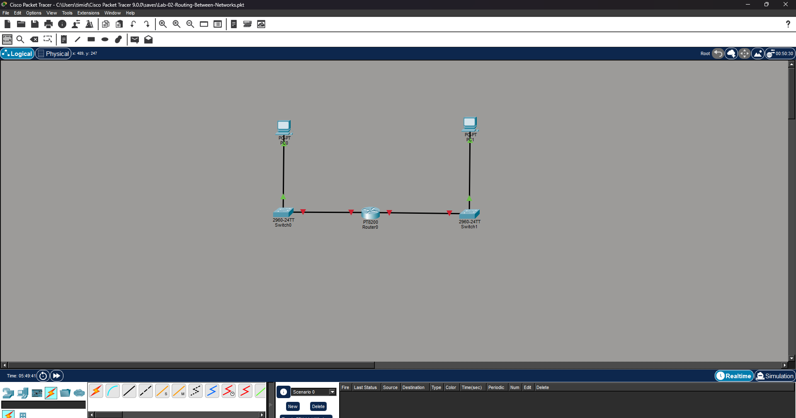
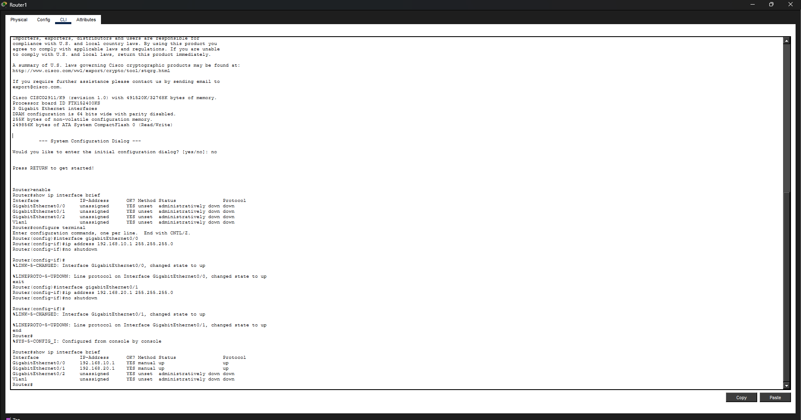
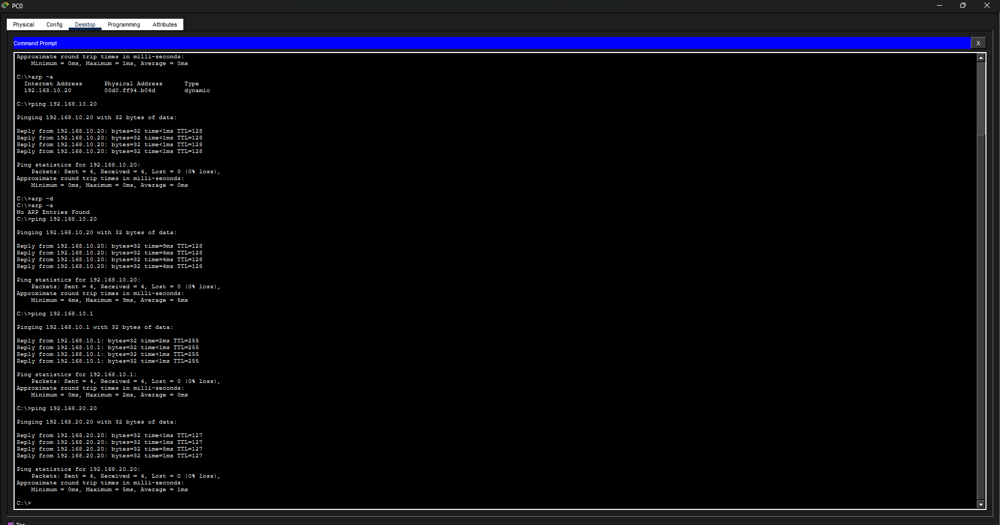
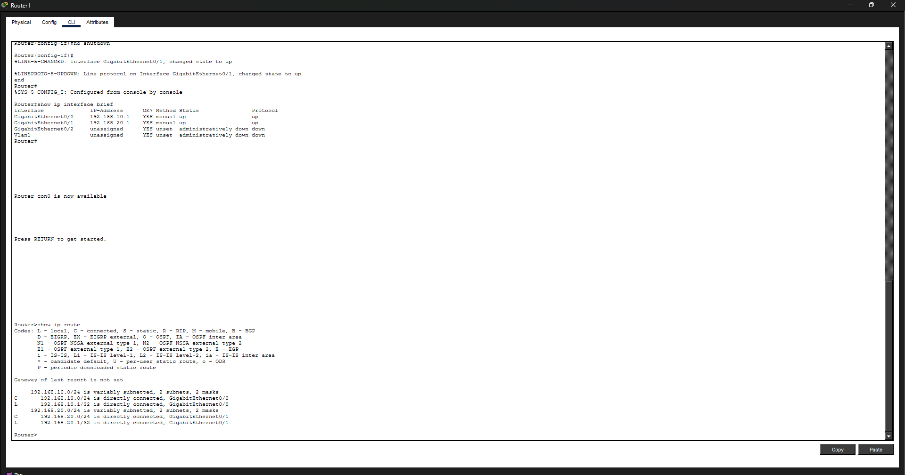
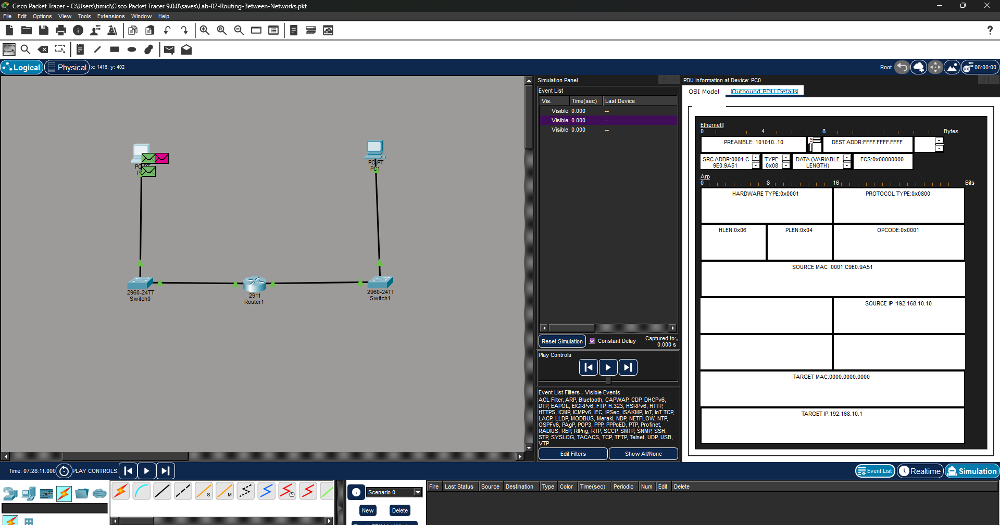
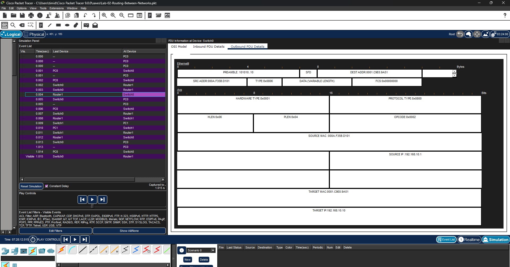
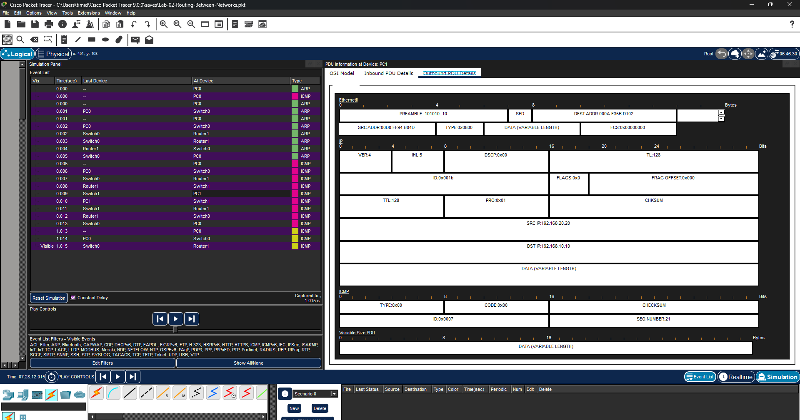

# Lab 02 — Routing Between Two Networks

## Project summary

This lab extends the basic switched LAN from Lab 01 by introducing a Cisco 2911 router and a second IPv4 network.

The objective was to demonstrate how hosts communicate across different subnets using default gateways, connected routes, ARP for next-hop resolution, and Layer 3 packet forwarding.

## Objectives

- Build two separate IPv4 networks.
- Configure Cisco 2911 router interfaces.
- Configure host default gateways.
- Verify local gateway reachability.
- Verify end-to-end communication across a router.
- Inspect the router routing table.
- Observe ARP behavior for remote destinations.
- Compare inbound and outbound Ethernet frames at the router.
- Observe TTL decrement across a Layer 3 hop.
- Analyze ICMP Echo Request and Echo Reply traffic in Simulation Mode.

## Topology

```text
192.168.10.0/24                           192.168.20.0/24

PC0                                           PC1
192.168.10.10                                 192.168.20.20
GW 192.168.10.1                               GW 192.168.20.1
     |                                             |
     |                                             |
Switch0                                         Switch1
     |                                             |
     | G0/0                                   G0/1 |
     +--------------- Router1 ---------------------+
                  192.168.10.1   192.168.20.1
```

## Devices

- 1 × Cisco 2911 router
- 2 × Cisco 2960 switches
- 2 × Packet Tracer PCs
- Copper Straight-Through Ethernet links

## Addressing plan

| Device | Interface | IPv4 Address | Subnet Mask | Default Gateway |
|---|---|---:|---:|---:|
| PC0 | FastEthernet0 | 192.168.10.10 | 255.255.255.0 | 192.168.10.1 |
| Router1 | GigabitEthernet0/0 | 192.168.10.1 | 255.255.255.0 | N/A |
| Router1 | GigabitEthernet0/1 | 192.168.20.1 | 255.255.255.0 | N/A |
| PC1 | FastEthernet0 | 192.168.20.20 | 255.255.255.0 | 192.168.20.1 |

## Router configuration

The two router interfaces were configured and enabled:

```text
configure terminal

interface gigabitEthernet0/0
 ip address 192.168.10.1 255.255.255.0
 no shutdown

interface gigabitEthernet0/1
 ip address 192.168.20.1 255.255.255.0
 no shutdown

end
```

Verification:

```text
show ip interface brief
```

Observed:

```text
GigabitEthernet0/0   192.168.10.1   up   up
GigabitEthernet0/1   192.168.20.1   up   up
```

## Gateway verification

PC0 successfully reached its default gateway:

```text
ping 192.168.10.1
```

Result:

```text
Packets: Sent = 4, Received = 4, Lost = 0 (0% loss)
```

PC1 also successfully reached its default gateway:

```text
ping 192.168.20.1
```

After the initial link/ARP settling period, the ping completed successfully with 0% packet loss.

## Routed connectivity test

From PC0:

```text
ping 192.168.20.20
```

Result:

```text
Packets: Sent = 4, Received = 4, Lost = 0 (0% loss)
```

This proved successful routing between:

```text
192.168.10.0/24
        ↓
      Router1
        ↓
192.168.20.0/24
```

The replies arrived with TTL 127, showing that the packet crossed one Layer 3 hop.

## Routing table

The router routing table was inspected with:

```text
show ip route
```

Observed connected and local routes:

```text
C 192.168.10.0/24 is directly connected, GigabitEthernet0/0
L 192.168.10.1/32 is directly connected, GigabitEthernet0/0

C 192.168.20.0/24 is directly connected, GigabitEthernet0/1
L 192.168.20.1/32 is directly connected, GigabitEthernet0/1
```

No static route was required because both destination networks were directly attached to the same router.

## Packet-level analysis in Simulation Mode

Packet Tracer Simulation Mode was used to inspect the routing process frame by frame.

### ARP for the default gateway

When PC0 attempted to reach PC1 on another subnet, it did not ARP for PC1 directly.

Instead, PC0 broadcast an ARP request for its default gateway:

```text
Source IP:       192.168.10.10
Target IP:       192.168.10.1
Destination MAC: FFFF.FFFF.FFFF
ARP Opcode:      0x0001
```

This demonstrates an important rule:

```text
Remote destination → resolve the next-hop router MAC
Local destination  → resolve the destination host MAC
```

### ARP Reply from Router1

Router1 G0/0 replied:

```text
Source IP:       192.168.10.1
Source MAC:      000A.F35B.D101
Target IP:       192.168.10.10
Target MAC:      0001.C9E0.9A51
ARP Opcode:      0x0002
```

PC0 could then forward the packet to the router at Layer 2 while preserving PC1 as the Layer 3 destination.

### ICMP Echo Request inbound to Router1

Inbound on G0/0:

```text
Ethernet source:      0001.C9E0.9A51
Ethernet destination: 000A.F35B.D101

IPv4 source:          192.168.10.10
IPv4 destination:     192.168.20.20
TTL:                  128
Protocol:             0x01 (ICMP)

ICMP Type:            8
ICMP Code:            0
```

The key distinction is:

```text
Layer 2 destination = Router G0/0
Layer 3 destination = PC1
```

### ICMP Echo Request outbound from Router1

After checking the routing table, Router1 forwarded the packet out G0/1.

```text
Ethernet source:      000A.F35B.D102
Ethernet destination: 000D.FF94.B04D

IPv4 source:          192.168.10.10
IPv4 destination:     192.168.20.20
TTL:                  127
Protocol:             0x01 (ICMP)

ICMP Type:            8
ICMP Code:            0
```

The router replaced the Layer 2 frame for the new LAN while preserving the end-to-end source and destination IP addresses.

TTL was decremented:

```text
128 → 127
```

### ICMP Echo Reply from PC1

PC1 sent the reply to its own default gateway:

```text
Ethernet source:      000D.FF94.B04D
Ethernet destination: 000A.F35B.D102

IPv4 source:          192.168.20.20
IPv4 destination:     192.168.10.10
TTL:                  128

ICMP Type:            0
ICMP Code:            0
```

Again, the Ethernet destination was the next-hop router, while the IPv4 destination remained the final remote host.

### ICMP Echo Reply outbound from Router1

Router1 forwarded the reply toward PC0:

```text
Ethernet source:      000A.F35B.D101
Ethernet destination: 0001.C9E0.9A51

IPv4 source:          192.168.20.20
IPv4 destination:     192.168.10.10
TTL:                  127

ICMP Type:            0
ICMP Code:            0
```

This confirmed successful routing in both directions.

## What the router changed

The lab directly demonstrated the difference between Layer 2 and Layer 3 forwarding.

```text
Before routing:
PC0 MAC → Router G0/0 MAC
192.168.10.10 → 192.168.20.20
TTL 128

After routing:
Router G0/1 MAC → PC1 MAC
192.168.10.10 → 192.168.20.20
TTL 127
```

The router:

1. Received the Ethernet frame.
2. Examined the IPv4 destination.
3. Checked the routing table.
4. Selected the outgoing interface.
5. Decremented TTL.
6. Built a new Ethernet frame for the next network.
7. Forwarded the packet.

## Key learning points

- Routers connect different IPv4 networks.
- Hosts use a default gateway for remote destinations.
- A host ARPs for the next-hop router, not for a host on a remote subnet.
- Directly connected networks are automatically installed in the routing table.
- Routers replace Layer 2 addressing at each routed hop.
- Source and destination IP addresses remain end-to-end in this lab.
- TTL is decremented by one at each router hop.
- ICMP Echo Request is Type 8.
- ICMP Echo Reply is Type 0.
- Layer 2 and Layer 3 addressing solve different forwarding problems.

## Security relevance

These routing fundamentals are directly relevant to SOC and network-security work.

A security analyst may need to understand:

- which gateway an endpoint should use
- why traffic is or is not crossing a subnet boundary
- how segmentation affects lateral movement
- whether a packet crossed a router based on TTL changes
- whether routing-table changes could redirect traffic
- how Layer 2 and Layer 3 evidence differ during an investigation
- whether unexpected ARP behavior involves a host or its gateway

Understanding normal inter-subnet routing is foundational for later labs involving VLANs, ACLs, NAT, OSPF, and segmentation controls.

## Evidence

### 1. Completed topology



### 2. Router interfaces up/up



### 3. Successful routed ping

PC0 successfully reached PC1 across the router with 0% packet loss.



### 4. Routing table

The router learned both directly connected networks automatically.



### 5. PC0 ARP request for the default gateway

PC0 resolved the MAC address of `192.168.10.1` rather than ARPing directly for the remote host.



### 6. Router ARP reply to PC0

Router1 G0/0 returned its MAC address to PC0.



### 7. ICMP Echo Request inbound to Router1

The inbound frame used PC0's MAC as source and Router1 G0/0 as destination while preserving PC1 as the IPv4 destination.


### 8. ICMP Echo Request outbound from Router1

Router1 rebuilt the Layer 2 frame for the right-hand LAN and decremented TTL from 128 to 127.


### 9. PC1 ICMP Echo Reply

PC1 sent the reply toward its default gateway because PC0 was on a remote subnet.



### 10. Router1 outbound ICMP Echo Reply

Router1 rebuilt the return frame for the left-hand LAN and forwarded the reply back to PC0 with TTL 127.


## Next exercise

Lab 03 will introduce VLAN segmentation so that one physical switching environment can contain multiple logically separated broadcast domains.
